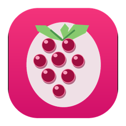
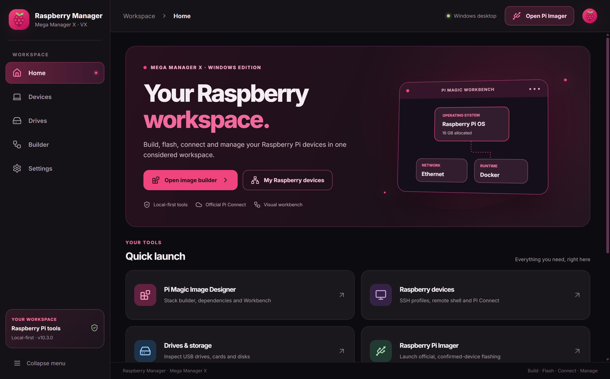
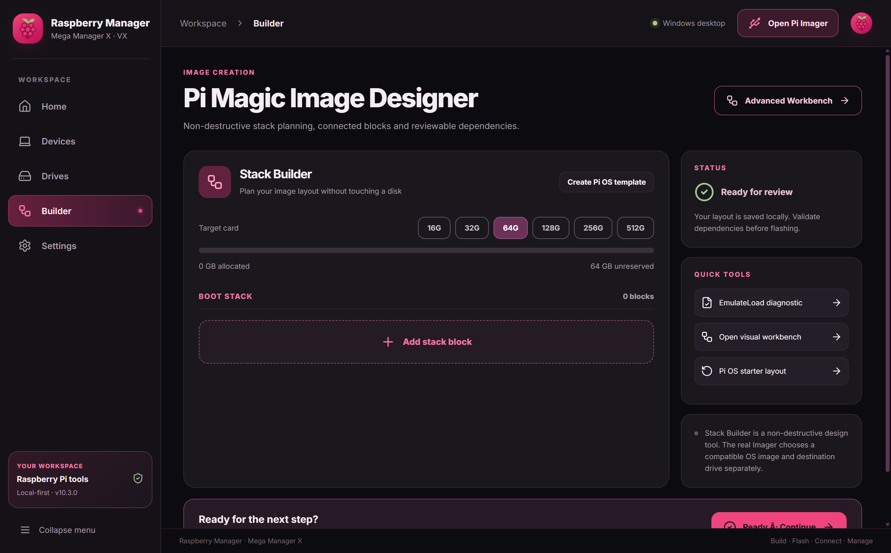
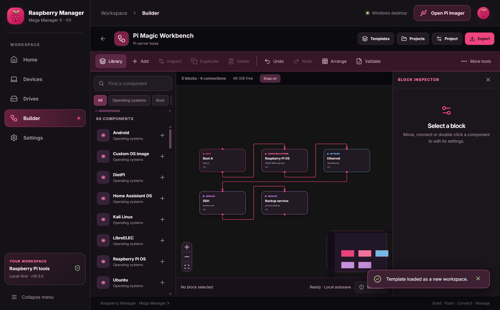
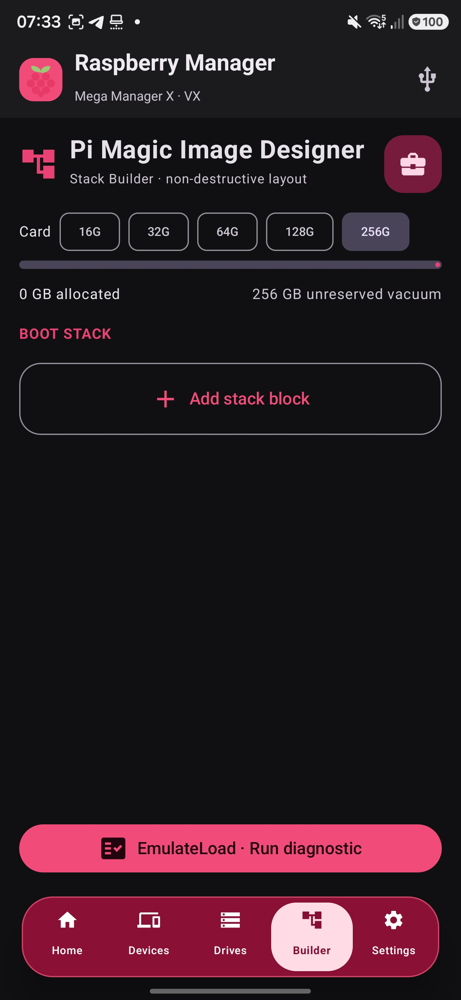
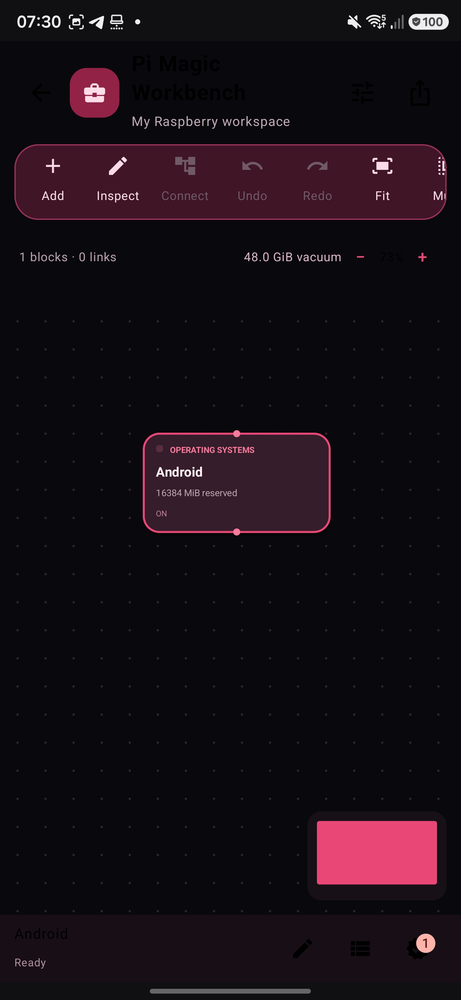
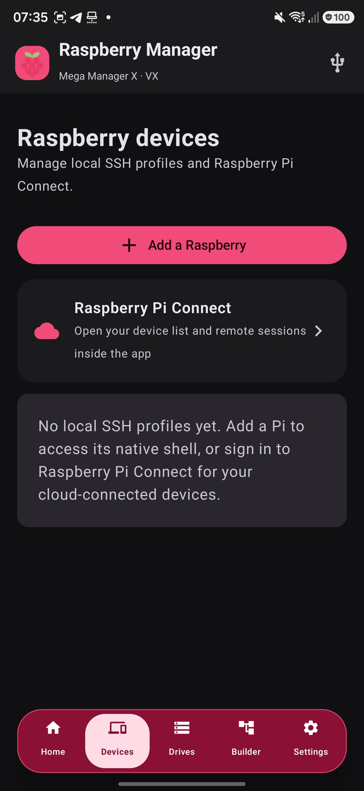

# Raspberry Manager

### Mega Manager X · VX

**Bauen. Flashen. Verbinden. Verwalten.**

Die Raspberry-Pi-Zentrale für **Android und Windows** – mit dem unverwechselbaren Raspberry-Berry-Design. 💜

[🇬🇧 English](README.md) · [🌐 Projektwebsite](https://ctrl-mietze.github.io/Raspberry-Manager/) · [📦 Releases](https://github.com/ctrl-mietze/Raspberry-Manager/releases/latest) · [🛠 Issues](https://github.com/ctrl-mietze/Raspberry-Manager/issues)

 &nbsp; 

Raspberry Manager v10.3.0 · Echter Screenshot der Windows-Anwendung

---

> [!IMPORTANT]
> **Unabhängiges Community-Projekt.** Raspberry Manager ist weder ein offizielles Produkt noch eine von Raspberry Pi Ltd unterstützte Anwendung. Das grafische Planen und die EmulateLoad-Diagnose sind **keine reale Firmware-Emulation** und erzeugen nicht automatisch bootfähige Multi-OS-Images. Echte Laufwerksschreibvorgänge erfolgen über passende Imaging-Werkzeuge mit separater Bestätigung.

## 💜 Worum geht es?

Raspberry Manager führt die wichtigsten Arbeitsschritte rund um Raspberry Pi in einer gemeinsamen Oberfläche zusammen. Normalerweise braucht man für Image-Vorbereitung, Gerätelogin, SSH-Terminal, Speicherübersicht und Flashen mehrere voneinander getrennte Programme.

Mit Raspberry Manager gehören diese Aufgaben in einen konsistenten Workspace:

- **Home:** Dein Startpunkt für Builder, Geräte, Laufwerke und Imager.
- **Pi Magic Image Designer:** Betriebssystem-, Boot- und Speicherblöcke als Konzept zusammenstellen.
- **Pi Magic Workbench:** Komponenten auf einem frei beweglichen Canvas verbinden, strukturieren, einstellen und exportieren.
- **EmulateLoad:** Abhängigkeiten und Fehlerfälle als Dry-Run prüfen.
- **Raspberry Devices:** Eigene SSH-Profile und echtes verschlüsseltes Terminal.
- **Raspberry Pi Connect:** Offizieller Anmelde- und Verbindungsdienst in einem eigenen, in der App eingebetteten Browserprofil.
- **Drives:** Reale Datenträger erkennen und ihre grundlegenden Informationen anzeigen.
- **Pi Imager:** Den richtigen nativen Imaging-Prozess starten.

Das Ziel ist eine leistungsfähige, verständliche App ohne sinnlose Dashboard-Spielereien oder vorgetäuschte Funktionen.

## 📥 Android-APK & Windows-EXE herunterladen

| Windows | Android |
| :-- | :-- |
| **Windows 10/11 x64** | **Android 9 oder neuer** |
| Komplettes Desktop-Setup | Native Android-App |
| Workbench, SSH, Drives, Pi Connect | Workbench, SSH, Drives, Pi Connect |
| Offizieller Raspberry Pi Imager | Eigener Android-Imager |
| [**Windows-Setup herunterladen**](https://github.com/ctrl-mietze/Raspberry-Manager/releases/latest/download/RaspberryManager-Windows-v10.3.0-Setup.exe) | [**Android-APK herunterladen**](https://github.com/ctrl-mietze/Raspberry-Manager/releases/latest/download/RaspberryManager-Android-v10.3.0.apk) |

Die ausführliche [Release-Seite](https://github.com/ctrl-mietze/Raspberry-Manager/releases/latest) enthält zusätzlich Versionshinweise und SHA-256-Prüfsummen.

**Windows:** Die Setup-EXE ist nicht mit einem kommerziellen Code-Signing-Zertifikat signiert. Windows SmartScreen kann deshalb eine Warnung anzeigen. Prüfe vor der Installation die SHA-256-Prüfsumme. Der originale Raspberry Pi Imager kann beim ersten Verwenden über den mitgelieferten offiziellen Installer eingerichtet werden.

**Android:** Verwende „Aktualisieren“, wenn die bisherige APK dieselbe Signatur hat. Bei unterschiedlicher Signatur lässt sich ein In-Place-Update möglicherweise nicht durchführen. Sichere App-Daten, bevor du etwas deinstallierst.

## 🖼️ Echte Screenshots

<table>
<tr><th width="50%">Pi Magic Image Designer</th><th width="50%">Pi Magic Workbench</th></tr>
<tr>
<td></td>
<td></td>
</tr>
<tr>
<td>OS-/Boot-/Storage-Stack, Speicherreservierung, Abhängigkeiten und Ready-Funktion.</td>
<td>Frei bewegliches Canvas, Blockkatalog, echte Verbindungen, Inspector und Projektvorlagen.</td>
</tr>
</table>

<strong>📱 Android-Designreferenzen ansehen</strong>

> Die folgenden Android-Aufnahmen stammen von der vorherigen v10.2-Oberfläche (27. Oktober 2026). Version 10.3 entfernt unter anderem den Startdialog und ändert Workbench- sowie Connect-Layout. Die Bilder sind **historische UI-Referenzen**, keine neuen Live-Screenshots sämtlicher v10.3-Änderungen.

<table><tr>
<td align="center" width="33%"> Image Designer</td>
<td align="center" width="33%"> Workbench</td>
<td align="center" width="33%"> Devices</td>
</tr></table>

Weitere große Screenshots und eine zweisprachige Landingpage: **[Raspberry Manager Website](https://ctrl-mietze.github.io/Raspberry-Manager/)**.

## 🧱 Image Designer und Ready-Ablauf

Der normale Image Designer bleibt bewusst einfach. Du kannst Komponenten hinzufügen, verschieben, verbinden und Größen festlegen.

Der untere Button **Ready · Continue** öffnet zwei unterschiedliche Optionen:

1. **EmulateLoad · Run diagnostic:** Prüft beispielsweise Speicherbelegung, fehlende Abhängigkeiten, Kreise im Abhängigkeitsgraphen und fehlende OS-Konfiguration.
2. **Flash on Device · Open Imager:** Startet den jeweiligen Imaging-Prozess. Ein echtes Image, Zielgerät und notwendige Löschbestätigung müssen dort gewählt werden.

EmulateLoad simuliert **keinen echten Raspberry-Pi-Bootvorgang**. Ein grafischer Stack allein ist auch kein fertiges Boot-Image.

## 🕸️ Pi Magic Workbench

Der erweiterte Workbench enthält **68 Blocktypen** aus neun Kategorien:

| Kategorie | Beispiele |
| :-- | :-- |
| Betriebssysteme | Raspberry Pi OS, Ubuntu, DietPi, LibreELEC, Android |
| Boot | Boot A/B, Kernel, Firmware, Boot-Konfiguration |
| Speicher | FAT32, ext4, Swap, Recovery, freie Reservierung |
| Treiber | USB, Wi-Fi, Display, GPU, Device Tree |
| Netzwerk | Ethernet, DNS, Firewall, VPN, Proxy |
| Laufzeitumgebungen | Java, Docker, Python |
| Minecraft | Java, Bukkit, Nukkit, Bedrock, Forge und Fabric als Planungsprofile |
| Dienste | SSH, Backup und weitere Systemdienste |
| Notizen | Freie Dokumentationsblöcke |

Du kannst Blöcke verschieben, verbinden, kopieren, gruppieren, ausrichten und in mehreren Richtungen verteilen. Der Inspector bietet Eigenschaften wie Name, Gruppe, Zustand, Reihenfolge, Notizen und weitere typspezifische Parameter.

**Zusätzliche Funktionen:** Auto-Layout, Vorlagen, Undo/Redo, Snap, Zoom, Minimap, JSON-Import/Export, SVG-Export, Simulation und Diagnosebericht.

Der gemeinsame Workbench-Dateityp hat das Format \`raspberry-workbench\` mit Schema-Version \`1\`. Die grundlegende Struktur ist auf Android und Windows kompatibel. Einige erweiterte Android-Funktionen und Exporte sind unter Windows noch nicht vollständig nachgebaut. Arbeite bei plattformübergreifenden Tests mit Sicherungskopien deiner Projekte.

### Minecraft ist ein Planungsbereich

Ein Minecraft-Block installiert nicht automatisch die entsprechende Serverversion. Beispielsweise benötigt der offizielle Bedrock Dedicated Server eine kompatible x86_64-Umgebung und läuft nicht nativ als ARM-Binary auf einem Raspberry Pi. Der Workbench soll solche Grenzen anzeigen, statt nicht vorhandene Kompatibilität zu versprechen.

## 🔌 Geräte und Raspberry Pi Connect

### Eigene SSH-Profile

Ein SSH-Profil besteht aus Anzeigename, IP/Hostname, Benutzername, Port und optionalem Pfad zum privaten SSH-Schlüssel. Das Windows-Terminal benutzt **ssh2 + xterm.js**.

- Neue Host-Fingerprints werden vor dem Vertrauen angezeigt.
- Änderungen an bereits bestätigten Fingerprints werden abgewiesen.
- SSH-Passwörter werden nicht in der Windows-Profilverwaltung gespeichert.
- Laufende Sessions lassen sich getrennt wieder schließen.

### Offizielle Raspberry Pi Connect-Anmeldung

Die Anwendung verwendet die **offizielle Raspberry Pi ID-Anmeldung** und die offiziellen Connect-WebRTC-Mechanismen. Das notwendige Browserprofil gehört zur App, ist vom normalen Browser getrennt und übernimmt keine fremden Cookies.

Die Geräteübersicht wird so weit wie möglich mit eigenen Bedienelementen im Raspberry-Design angezeigt. Wenn eine Loginseite, ein echtes WebRTC-Terminal oder eine Bildschirmübertragung benötigt wird, bleibt die Darstellung beim offiziellen Client. Das ist wichtig für Kompatibilität und Sicherheit.

Die Verfügbarkeit echter Remote-Sessions hängt von der aktuellen Raspberry-Pi-Connect-Version, Netzverbindung, Konto, Pi-Konfiguration und den angebotenen Diensten ab. Eine ungetestete Anmeldung wird nicht als garantiert funktionierend bezeichnet.

## 💽 Laufwerke und echtes Flashing

Unter **Windows** zeigt Raspberry Manager angeschlossene Laufwerke mit Kapazität, Schnittstelle und grundlegenden Informationen an. Diese Übersicht schreibt keine Bytes auf Datenträger.

Beim Flashen öffnet die App den **offiziellen Raspberry Pi Imager**. Falls dieser noch nicht installiert ist, kann die veröffentlichte Windows-Version optional dessen unveränderten Installer starten. Die eigentliche Image-Auswahl, Zielauswahl und Löschbestätigung verbleiben beim Imager.

Unter **Android** bleibt der bisherige native Imaging-Ablauf erhalten. Das **USB-Symbol oben rechts** wird weiterhin angezeigt.

> [!WARNING]
> Ein bestätigter Schreibvorgang auf dem falschen USB-Laufwerk oder der falschen SD-Karte kann Daten dauerhaft löschen. Erstelle eine Sicherung, bevor du eigene Bootmedien veränderst.

## 📂 Aufbau des Repositorys

\`\`\`text
Raspberry-Manager/
├── README.md / README.de.md
├── CHANGELOG.md
├── CONTRIBUTING.md
├── SECURITY.md
├── NOTICE.md
├── android/
│   ├── source/       # Android Kotlin und Jetpack Compose
│   └── UPSTREAM.md   # Raspberry Pi Imager Attribution
├── windows/
│   ├── src/          # React und Workbench-Logik
│   ├── desktop/      # Electron-Integration, SSH, WebView
│   ├── assets/       # Icon und Adapter
│   └── scripts/      # Asset-/Kataloggeneratoren
├── docs/
│   ├── index.html    # GitHub Pages
│   ├── style.css
│   ├── app.js
│   └── assets/       # Screenshots und Illustrationen
└── .github/workflows/
\`\`\`

Große Installationspakete befinden sich unter **GitHub Releases** und werden nicht mit jedem Source-Clone heruntergeladen.

## 🛠 Selbst kompilieren

### Windows

Benötigt Node.js 24, npm und Windows 10/11.

\`\`\`powershell
git clone https://github.com/ctrl-mietze/Raspberry-Manager.git
cd Raspberry-Manager\windows

npm ci
npm run build:web
npx tsc --noEmit
npm test
npm run dev
\`\`\`

Einen Installer erzeugen:

\`\`\`powershell
npm run build
\`\`\`

Standard-Ausgabepfad: \`windows/release/RaspberryManager-Windows-v10.3.0-Setup.exe\`.

Der optionale Original-Imager-Installer ist nicht im Git-Quellverlauf enthalten. Ohne diese Datei kann der selbstgebaute Windows-Client auf die offizielle Imager-Website verweisen.

### Android

Benötigt JDK 17 und Android SDK 35.

\`\`\`bash
git clone https://github.com/ctrl-mietze/Raspberry-Manager.git
cd Raspberry-Manager/android/source

./gradlew :app:assembleDebug :app:testDebugUnitTest
\`\`\`

Auf **Android/Termux** verwende `bash scripts/build-current-on-termux.sh`. Das Skript wählt die native ARM64-Version von AAPT2 automatisch aus, ohne Termux-Pfade fest in die gemeinsam genutzten Gradle-Einstellungen zu schreiben.

Ausgabe: \`app/build/outputs/apk/debug/app-debug.apk\`. Lokale Debug-Signaturen können sich von der bereits installierten APK unterscheiden.

## 🧪 Tests und Grenzen

**Android v10.3.0:**
- Gradle-Debug-Build erfolgreich.
- 279 JVM-Tests, davon 278 bestanden, 1 übersprungen und 0 fehlgeschlagen.
- 33 Tests des Raspberry-Pi-Connect-DOM-Adapters bestanden.
- 18 Clipboard-Tests bestanden.
- APK und Signatur gegen vorherigen Build geprüft.

**Windows v10.3.0:**
- TypeScript und Vite-Produktionsbuild.
- Echter Windows-x64-Installer mit electron-builder/NSIS.
- Home, Image Designer und Workbench in der laufenden Windows-App aufgenommen.

**Noch keine vollständige Garantie:** Live-Anmeldung bei Pi Connect, Funktionsgleichheit sämtlicher Android-/Windows-Details, echtes Flashing auf verschiedenen Kartenlesern, alle Pi-Firmwarevarianten und Langzeittests sind nicht durch den bloßen erfolgreichen Build nachgewiesen.

Diese Version ist deshalb ein **experimenteller Community-Release**, keine produktionszertifizierte Imaging-Suite.

## 🔐 Sicherheit

- App-Prozesse und WebView-Profile bleiben logisch getrennt.
- Der Windows-Electron-Renderer besitzt keine uneingeschränkte Node.js-Integration.
- SSH-Hostschlüssel werden geprüft.
- Kein automatisches Auslesen von Browsercookies.
- Keine automatische Ausführung fremder Workbench-Inhalte.
- Keine automatische Löschung von Datenträgern.
- Veröffentlichung mit SHA-256-Prüfsummen.

Sicherheitsrelevante Berichte gehören in [SECURITY.md](SECURITY.md). Niemals Passwörter, SSH-Keys oder private Geräte-Logs in öffentlichen Issues veröffentlichen.

## 🗺️ Roadmap

- [ ] Umfangreichere End-to-End-Tests mit Raspberry Pi 4 und Pi 5.
- [ ] Vollständige Vergleichs- und Regressionstests für Android ↔ Windows.
- [ ] Erweiterte Windows-Workbench-Exportoptionen.
- [ ] Gemeinsame Projekte und verbesserte Dateimigration.
- [ ] Weitere deutsche Übersetzungen in der App.
- [ ] Signierte Windows-Releases.
- [ ] Umfangreicheres Geräte- und Verbindungs-Debugging.

Diese Punkte sind geplant und werden **nicht** als fertig ausgegebene Funktionen geführt.

## 🫶 Mitmachen

Du hast einen Bug, eine Verbesserungsidee oder einen eigenen getesteten Patch? Lies bitte [CONTRIBUTING.md](CONTRIBUTING.md) und eröffne ein Issue oder einen Pull Request.

Besonders wertvoll sind präzise Angaben zu Hardware, Windows-/Android-Version, Verhalten vor und nach der Änderung sowie anonymisierte Debug-Logs.

## ⚖️ Lizenz und Herkunft

Der Projekt-Source ist unter [Apache License 2.0](LICENSE) veröffentlicht. Für eingebundene Bestandteile gelten die jeweiligen Original-Lizenzen.

Raspberry Manager ist **kein offizielles Raspberry-Pi-Produkt**. Die Bezeichnungen Raspberry Pi, Raspberry Pi Connect und Raspberry Pi Imager gehören ihren jeweiligen Rechteinhabern. Die Hinweise zum offiziellen Imaging-Programm und den verwendeten Grundlagen stehen in [NOTICE.md](NOTICE.md) und [android/LICENSE-RPI-IMAGER.txt](android/LICENSE-RPI-IMAGER.txt).

---

**Raspberry Manager · Mega Manager X · VX**

*Built for the joy of tinkering with tiny computers.*

[⬆ Nach oben](#raspberry-manager)

