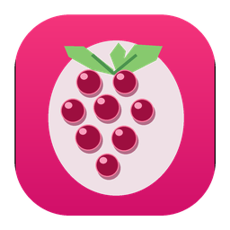
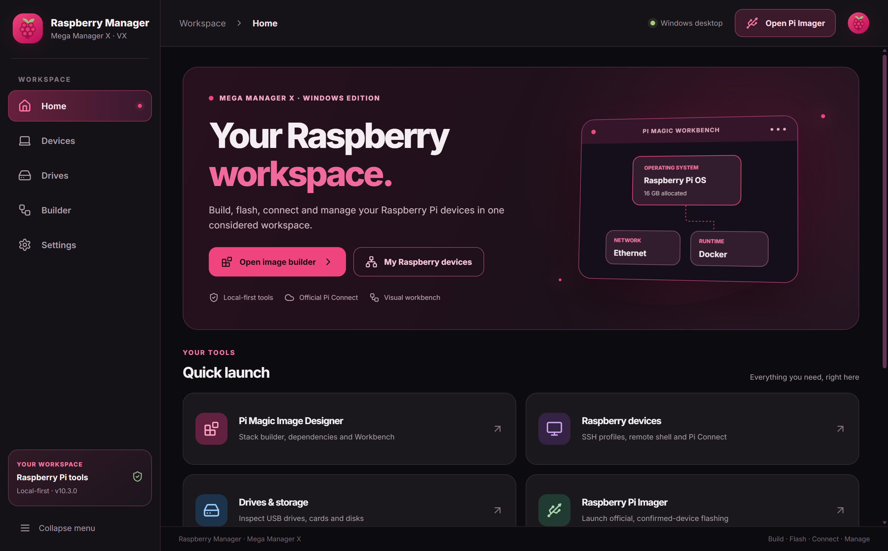
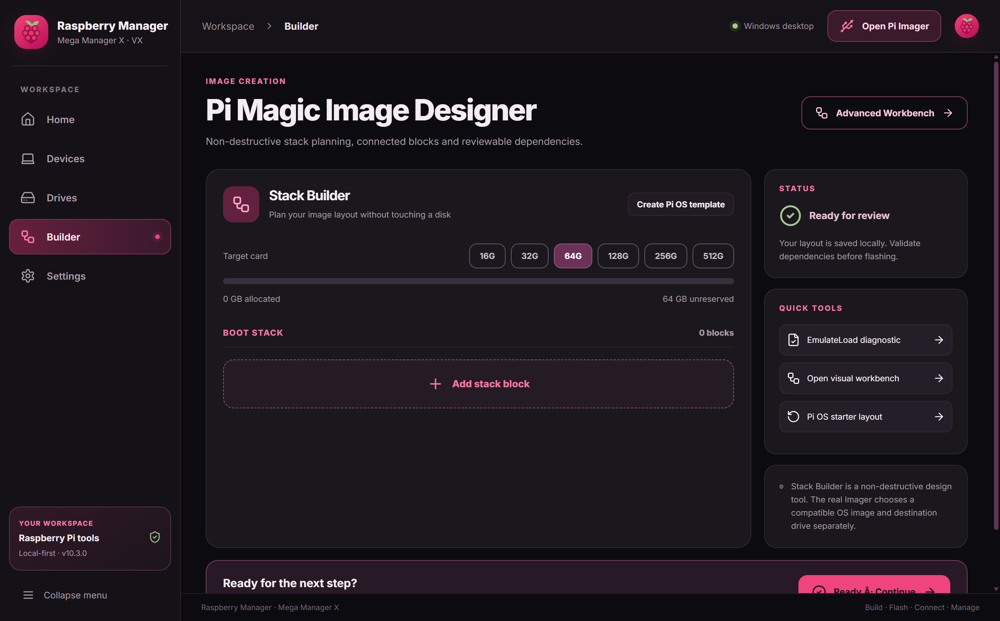
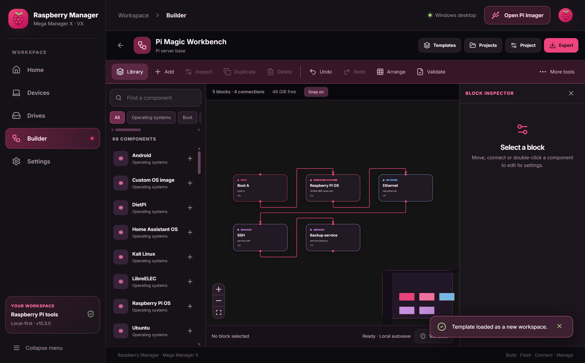
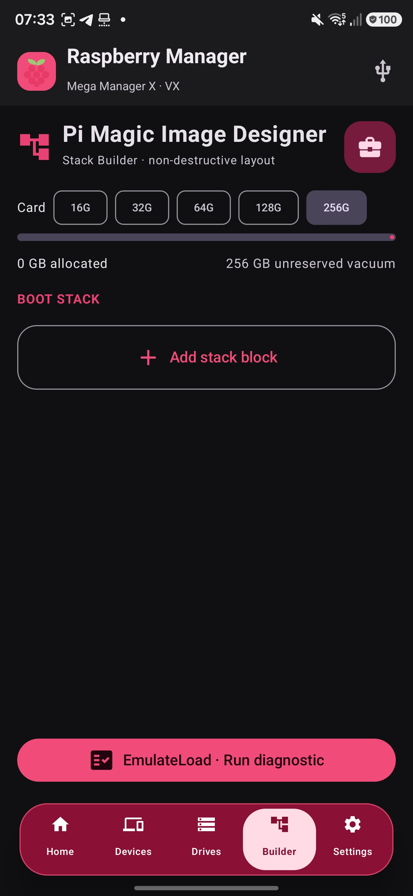
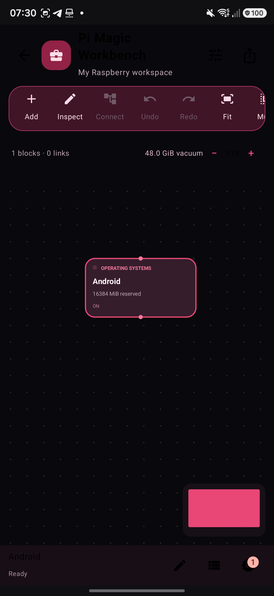
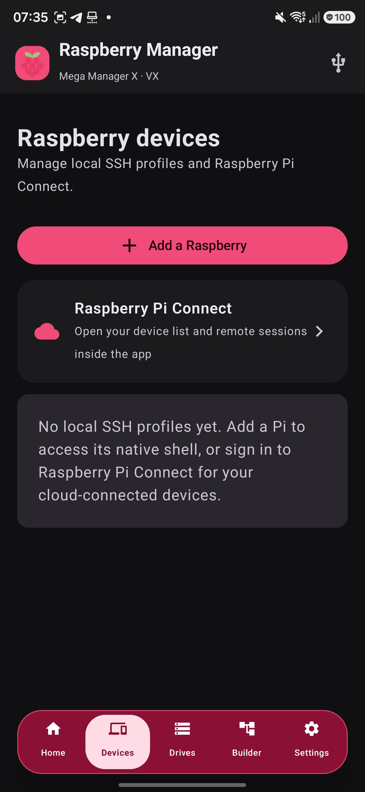

  

  # Raspberry Manager

  ### Mega Manager X · VX

  **Build. Flash. Connect. Manage.**  
  A Raspberry Pi workspace for **Android** and **Windows** — with an unmistakable Berry interface.

  

    <a href="README.de.md">🇩🇪 Deutsch</a>
    &nbsp;·&nbsp;
    <a href="https://ctrl-mietze.github.io/Raspberry-Manager/">🌐 Project website</a>
    &nbsp;·&nbsp;
    <a href="https://github.com/ctrl-mietze/Raspberry-Manager/releases/latest">📦 Latest release</a>
    &nbsp;·&nbsp;
    <a href="https://github.com/ctrl-mietze/Raspberry-Manager/issues">🛠 Issues</a>
  

  

    
    
    
    
  

  
 &nbsp; 

---

  
  
Real Windows application screenshot • Raspberry Manager v10.3.0 • Raspberry Berry

> [!IMPORTANT]
> **Raspberry Manager is an independent project, not an official Raspberry Pi product.**  
> The **Pi Magic Image Designer** and **EmulateLoad** are *planning and diagnostic tools*. They do **not** boot actual firmware, create bootable multi-OS images automatically, or guarantee hardware compatibility. Physical flashing is handled through platform-specific imaging workflows with explicit target confirmation.

## ✨ Why Raspberry Manager?

Raspberry Manager brings the parts of a Raspberry Pi workflow that normally live in separate apps into one coherent place: planning an image, organizing its components, connecting to a Pi, inspecting storage, and launching the correct imaging process.

The goal is not to hide powerful tools behind vague “one click” claims. The goal is to make them **accessible, understandable, visually consistent and safe to operate**. Raspberry Manager keeps a clear separation between:

- **Designing** a boot, operating-system, storage or service plan.
- **Validating** constraints and simulating dependency order.
- **Connecting** to real, authorized devices over SSH or official Raspberry Pi Connect.
- **Flashing** an actual image via a platform-native writer with separate device/erase confirmation.

The Android and Windows editions share the same Berry design language and central workflows while using the correct native capabilities of their respective platforms.

## ⬇️ Download

<table>
<thead><tr><th width="50%">🪟 Windows desktop</th><th width="50%">🤖 Android</th></tr></thead>
<tbody>
<tr>
<td align="center">
<strong>Raspberry Manager Windows 10.3.0</strong> 
Windows 10 / 11 · x64 · installer (.exe)
  

</td>
<td align="center">
<strong>Raspberry Manager Android 10.3.0</strong> 
Android 9+ · APK
  

</td>
</tr>
</tbody>
</table>

**Prefer one page with both downloads, documentation and screenshots?**  
→ **[Open the Raspberry Manager project website](https://ctrl-mietze.github.io/Raspberry-Manager/)**

All release assets are distributed through [GitHub Releases](https://github.com/ctrl-mietze/Raspberry-Manager/releases), **not stored as enormous binaries in Git history**. Each release includes a \`SHA256SUMS.txt\` file for checking downloaded files.

<strong>Verify your download</strong>

Windows PowerShell:

\`\`\`powershell
Get-FileHash .\RaspberryManager-Windows-v10.3.0-Setup.exe -Algorithm SHA256
\`\`\`

Linux, macOS or Termux:

\`\`\`bash
sha256sum RaspberryManager-Android-v10.3.0.apk
\`\`\`

Compare the result to the corresponding line in the release's \`SHA256SUMS.txt\`. A checksum only proves that your copy matches the published asset; it is not a general security audit.

## 🖥️ Take a tour

<table>
<tr>
<td width="50%">
  
  <h4>01 — Pi Magic Image Designer</h4>
  Make a non-destructive OS / boot / storage layout with capacity tracking, dependencies and a clear next-step flow.
</td>
<td width="50%">
  
  <h4>02 — Pi Magic Workbench</h4>
  Move, connect, organize, inspect and validate blocks on an interactive canvas.
</td>
</tr>
</table>

<strong>📱 See the Android design reference captures</strong>

> Android reference screenshots below were taken from the preceding v10.2 UI on 27 October 2026. The v10.3 build removes the startup chooser and updates the Workbench layout and native Connect UI. These pictures are historical design references, not a claim of live screenshot validation for every change in v10.3.

<table><tr>
<td align="center" width="33%"> Android Image Designer</td>
<td align="center" width="33%"> Android Workbench</td>
<td align="center" width="33%"> Android Devices</td>
</tr></table>

**The interface in these screenshots is the real Windows build**, not a mockup of an imaginary feature. The [website gallery](https://ctrl-mietze.github.io/Raspberry-Manager/#gallery) provides larger views.

### A workspace, not six disconnected utilities

| Area | What you can do |
| :-- | :-- |
| 🏠 **Home** | Open your essential tools, see local profiles and storage overview |
| 🧱 **Image Designer** | Assemble a conceptual image stack, allocate space, model dependencies |
| 🕸️ **Workbench** | Arrange and connect visual nodes, edit attributes, create project templates |
| 🧠 **EmulateLoad** | Validate allocation and simulate dependency/failure scenarios |
| 🖥️ **Devices** | Save local SSH profiles; connect through an encrypted SSH terminal |
| ☁️ **Pi Connect** | Use the official Raspberry Pi ID and Connect client inside the app |
| 💽 **Drives** | See real connected storage devices and capacity information |
| 🔌 **Imager** | Open the native writer or official Raspberry Pi Imager flow, as appropriate |
| ⚙️ **Settings** | Manage visual preferences and integration information |

---

## 🧱 Pi Magic Image Designer

The Image Designer is the simpler side of the image-planning workflow: a guided stack with explicit size and dependency choices.

**Included workflows**

- Operating-system declarations including Raspberry Pi OS, Ubuntu, DietPi, Home Assistant OS, LibreELEC, Kali Linux and Android planning entries.
- Boot components, kernel/initramfs, boot selection, driver and overlay references.
- Storage reservations and optional recovery declarations.
- Card-capacity presets and live reserved/unallocated calculations.
- Block reordering, linking and resizing.
- Diagnostics for missing OS, missing dependencies, circular dependencies and over-allocation.
- A deliberate **Ready · Continue** step.

The Ready flow offers two distinct actions:

1. **EmulateLoad · Run diagnostic** — a non-destructive validation and planning simulation.
2. **Flash on Device · Open Imager** — a real imaging-tool launch, where an actual compatible image, target and erase confirmation must be chosen.

> [!NOTE]
> A prepared *plan* is not automatically a complete bootable SD card. A real disk image still has to be provided or selected in the native imaging workflow.

## 🕸️ Advanced Pi Magic Workbench

For people who want a richer model, Workbench turns components and dependencies into a graphical canvas. It uses the same **Raspberry Berry** design vocabulary in both apps.

### 68 block types / 9 categories

| Category | Examples |
| :-- | :-- |
| **Operating systems** | Raspberry Pi OS, Ubuntu, DietPi, LibreELEC, Android |
| **Boot** | Boot A/B, firmware, kernel, selector, config fragments |
| **Storage** | FAT32 boot volume, ext4, swap, recovery, reserved free space |
| **Drivers** | USB, Wi-Fi, display, GPU, device-tree overlays |
| **Network** | Ethernet, Wi-Fi, DNS, firewall, VPN, proxy |
| **Runtimes** | Java, Docker, Python and related runtimes |
| **Minecraft** | Java, Bukkit, Nukkit, Bedrock, Forge and Fabric planning |
| **Services** | SSH, backups and other service declarations |
| **Notes** | Free-form annotations |

### Editing & productivity

- Canvas panning, zooming, snapping and overview map.
- Drag-and-drop nodes and configurable connections.
- Node inspector: names, grouping, enable/disable, priority, notes, runtime settings.
- Undo/redo, copy/duplicate, select, group, lock and arrange.
- Align top/bottom/left/right and distribute nodes into rows, columns or grids.
- Saved workspaces and project templates.
- Validation, error and warning reporting.
- Export to portable Workbench JSON and SVG diagrams; additional platform-specific exports may differ.
- A bounded schema (up to **256 nodes** and **1,024 links**).

**Android / Windows JSON compatibility:** both editions understand the \`raspberry-workbench\` schema v1 with \`nodes\` and \`links\`. Some advanced Android-specific settings/export helpers do not yet have identical Windows UI equivalents. Preserve backup copies when moving active projects between platforms.

### Minecraft support: accurate by design

Minecraft profiles help **plan** a runtime and server setup; simply adding a node does not install Minecraft or run a server. For example, official Bedrock Dedicated Server binaries target **x86_64**, and are not native Raspberry Pi ARM executables. The validator surfaces architectural constraints rather than declaring a plan to be working on unsupported hardware.

---

## 🖥️ Devices: local SSH and Raspberry Pi Connect

Raspberry Manager supports two complementary connections, with deliberately different security boundaries.

### Local SSH

The device manager can save the display name, host, port, username and optional private-key path for a Raspberry Pi. It opens a terminal session using SSH.

**Windows edition**

- Dedicated terminal with xterm.js.
- SSH transport with the \`ssh2\` library.
- Password or private-key authentication.
- No persistent SSH password database in Raspberry Manager.
- First-connection host fingerprint approval; previously trusted fingerprint changes are rejected.
- Terminal resizing and proper session shutdown.

**Android edition**

- Existing native SSH profile and terminal workflow is retained.
- Connection behavior depends on Android's available network and storage APIs.

### Official Raspberry Pi Connect

Pi Connect enables remote access without requiring your phone/PC and the Pi to share a Wi-Fi network, provided the official service and device are configured correctly.

Raspberry Manager does **not** clone the identity provider. It embeds the official service in an app-controlled browser environment and represents supported device actions with native controls where possible.

| Concern | Approach |
| :-- | :-- |
| Authentication | Official Raspberry Pi ID |
| Passwords/tokens | Managed by the official provider within the embedded profile |
| Data isolation | Dedicated app browser profile, separate from your normal system browser |
| Remote desktop / shell | Official Raspberry Pi Connect WebRTC client |
| Website changes | Native adapter may need an update; unknown actions should not be guessed |
| Headless OS Lite | Remote shell may be available; desktop sharing needs the appropriate graphical environment |

A remote view is shown when the provider needs to render its own terminal, desktop or authentication interface. This is intentional: a native-looking shell should **not** break the provider's security model.

> [!WARNING]
> No live sign-in with someone else's account is included in automated tests. Successful connection still depends on Raspberry Pi Connect's current client behavior, account state, device configuration and network conditions.

---

## 💽 Real storage, honest flashing

### Windows

Windows drive information comes from system inventory APIs. It is **read-only** in the Raspberry Manager drive screen.

When you choose **Open Raspberry Pi Imager**, the app:

1. Looks for an already installed official Raspberry Pi Imager executable.
2. If absent and the optional official installer is bundled, asks whether you want to launch that installer.
3. Otherwise, opens the official download website.

The actual SD/USB imaging operation remains under the **official Raspberry Pi Imager**. The user explicitly selects the OS/image and destination and confirms destructive writes.

### Android

The Android edition keeps its existing USB/SD imaging wizard and upper-right **USB** launch icon. The planning Workbench remains separate from physical media writing.

**Do not flash data-bearing drives without making an independent backup.** Choosing the wrong disk can permanently destroy its contents.

---

## 🎨 Design

Raspberry Manager is built around a small, coherent visual language rather than a noisy “AI dashboard”:

- True near-black surfaces and calm Berry/Pink accents.
- Defined component elevation, carefully contrasted metadata, readable labels.
- Responsive landscape/portrait editor layouts, including narrower workbench rails on mobile.
- Minimal transitions, explicit active states and visible error feedback.
- The same iconography and product identity on Android and Windows.

Artwork and screenshots live under [\`docs/assets/\`](docs/assets/). Real application screenshots are used for the gallery; the Raspberry Pi board drawing is a custom **illustration**, not an official product photograph.

---

## 📁 Repository structure

\`\`\`text
Raspberry-Manager/
├── README.md                    # English project overview
├── README.de.md                 # German project overview
├── CHANGELOG.md                 # Release history
├── CONTRIBUTING.md              # Development workflow
├── SECURITY.md                  # Responsible issue reporting
├── NOTICE.md                    # Upstream & trademark attribution
├── LICENSE                      # Project license
├── android/
│   ├── source/                  # Android Kotlin + Jetpack Compose project
│   │   ├── app/src/main/
│   │   ├── app/src/test/
│   │   ├── gradle/
│   │   └── gradlew
│   ├── UPSTREAM.md
│   └── LICENSE-RPI-IMAGER.txt
├── windows/
│   ├── desktop/                 # Electron main/preload processes
│   ├── src/
│   │   ├── components/          # React application screens
│   │   ├── logic.ts             # Layout and validation logic
│   │   └── catalog.json         # Shared 68-block catalog selection
│   ├── assets/                  # Branding and Connect adapter
│   ├── scripts/                 # Catalog and asset generation
│   ├── tests/
│   ├── package.json
│   └── package-lock.json
├── docs/                        # GitHub Pages website
│   ├── index.html
│   ├── style.css
│   ├── app.js
│   └── assets/                  # Actual screenshots and project artwork
└── .github/workflows/           # CI workflows
\`\`\`

**Where are the APK and EXE?** → On the [Releases page](https://github.com/ctrl-mietze/Raspberry-Manager/releases/latest), where you can download them directly without cloning the source.

## 🛠 Build from source

### Requirements

| Android | Windows |
| :-- | :-- |
| JDK 17 | Node.js 24 |
| Android SDK 35 | npm |
| Android Gradle Plugin | Windows 10 / 11 x64 |
| Android Studio or compatible Gradle environment | Python not required for basic build |
| USB hardware only for real imaging tests | Optional Raspberry Pi Imager installation |

### Build Android

\`\`\`bash
git clone https://github.com/ctrl-mietze/Raspberry-Manager.git
cd Raspberry-Manager/android/source

./gradlew :app:assembleDebug :app:testDebugUnitTest
\`\`\`

On **Termux on Android**, use `bash scripts/build-current-on-termux.sh` instead. This selects Termux-native AAPT2 automatically without hardcoding its path into shared Gradle settings.

On Windows replace \`./gradlew\` with \`gradlew.bat\`. The default output is \`app/build/outputs/apk/debug/app-debug.apk\`. Builds use the **local debug signing key**, which may not match an APK you previously installed. Do not uninstall an existing installation merely to test a different signature unless you have backed up its app data.

### Build Windows

\`\`\`powershell
git clone https://github.com/ctrl-mietze/Raspberry-Manager.git
cd Raspberry-Manager\windows

npm ci
npm run build:web
npx tsc --noEmit
npm test
npm run dev
\`\`\`

To package the full setup installer:

\`\`\`powershell
npm run build
\`\`\`

Output: \`windows/release/RaspberryManager-Windows-v10.3.0-Setup.exe\`.

The optional \`windows/assets/imager-v2.0.12.exe\` is **not stored in Git history**. Local builds that do not bundle it use an official Imager installation or official upstream download page. The published Windows release may include the original upstream installer as a convenience. Never treat an external installer as Raspberry Manager's own binary.

### GitHub Actions

The CI workflows are intended to validate source compilation and tests on supported runners. A **green build** proves that the sources compile under that environment; it is not a substitute for Raspberry Pi hardware, driver, network, remote-desktop or disk-write testing.

---

## 🔐 Privacy and security

| Area | Principle |
| :-- | :-- |
| SSH profiles | Host/user metadata stored locally; passwords not persisted by the Windows profile store |
| SSH host identity | Unknown fingerprints require approval; trusted changes are rejected |
| Connect login | Official embedded ID page, separated from ordinary browser cookies |
| App UI | Electron renderer runs without Node.js integration and exposes an allowlisted preload API |
| Device storage | Listing disks does not write to them |
| Project files | Validate imported JSON and keep bounded structures |
| Logs | Sanitize secrets and identifying information before sharing |
| Downloads | Verify release SHA-256 checksums |

For sensitive problems read [SECURITY.md](SECURITY.md). Do not paste secrets or personally identifying device logs in public issues.

---

## ✅ Verification and scope

### Android v10.3.0

- **Build:** Gradle \`assembleDebug\` succeeded.
- **JVM tests:** 279 total — 278 passed, 1 skipped, 0 failed.
- **Connect DOM tests:** 33 passed.
- **Clipboard adapter tests:** 18 passed.
- **APK:** archive/signature verified; signing certificate matched the v10.2.0 baseline.

### Windows v10.3.0

- **Source:** TypeScript and Vite production build.
- **Packaging:** Windows x64 NSIS installer produced with electron-builder.
- **UI:** Actual application launched and its Home, Image Designer and Workbench were screenshot-captured.
- **Known limits:** Exact Android/Windows feature parity, first-party camera/screen capture, live Pi Connect login, real SSH session to each supported Pi model, system-level disk flashing, and arbitrary hardware configurations are **not certified by the build result**.

> [!CAUTION]
> **Current release is an experimental community build**, not a fully certified production imaging suite. Have a recovery/backup path before testing new boot media or privileged integrations.

---

## 🗺️ Roadmap

These are **plans**, not features already claimed to be implemented.

- [ ] Full cross-platform parity matrix with end-to-end device tests
- [ ] Improve true Android ↔ Windows Workbench project round-trip coverage
- [ ] Persist more advanced inspector fields and add schema migration tests
- [ ] Expand automated UI accessibility and resize testing
- [ ] Add repeatable Raspberry Pi 4 / 5 test matrices for SSH and Connect
- [ ] Better localization for both applications
- [ ] Signed Windows distribution and verified update mechanism
- [ ] Release notes, reproducible artifacts and supply-chain improvements

Use [GitHub Issues](https://github.com/ctrl-mietze/Raspberry-Manager/issues) for bug reports and suggestions.

## 🤝 Contributing

Please read [CONTRIBUTING.md](CONTRIBUTING.md). Keep contributions reviewable, tested and explicit about the difference between “planned”, “simulated”, “generated” and “executed”.

| Useful links | |
| :-- | :-- |
| 🌐 Website | [Raspberry Manager project page](https://ctrl-mietze.github.io/Raspberry-Manager/) |
| 📦 Downloads | [GitHub Releases](https://github.com/ctrl-mietze/Raspberry-Manager/releases) |
| 🐛 Bug reports | [Issues](https://github.com/ctrl-mietze/Raspberry-Manager/issues) |
| 🧭 Changes | [Changelog](CHANGELOG.md) |
| 🔐 Security | [Security policy](SECURITY.md) |
| 📄 Upstream notices | [Attribution](NOTICE.md) |
| 🇩🇪 Deutsch | [German README](README.de.md) |

## ⚖️ License & attribution

Raspberry Manager project sources are made available under the **[Apache License 2.0](LICENSE)**, subject to the third-party notices and licenses applicable to bundled or integrated components.

**Not affiliated with Raspberry Pi Ltd.** “Raspberry Pi”, “Raspberry Pi Connect” and “Raspberry Pi Imager” are names/trademarks of their respective owners. This project uses the official service and Imager through clearly identified integration boundaries. The upstream attribution and original Imager license are kept in [NOTICE.md](NOTICE.md) and [android/LICENSE-RPI-IMAGER.txt](android/LICENSE-RPI-IMAGER.txt).

---

**Raspberry Manager** · Mega Manager X · VX  
*Made for people who love building things with little computers.*

**Build · Flash · Connect · Manage**

[⬆ Back to top](#raspberry-manager)

