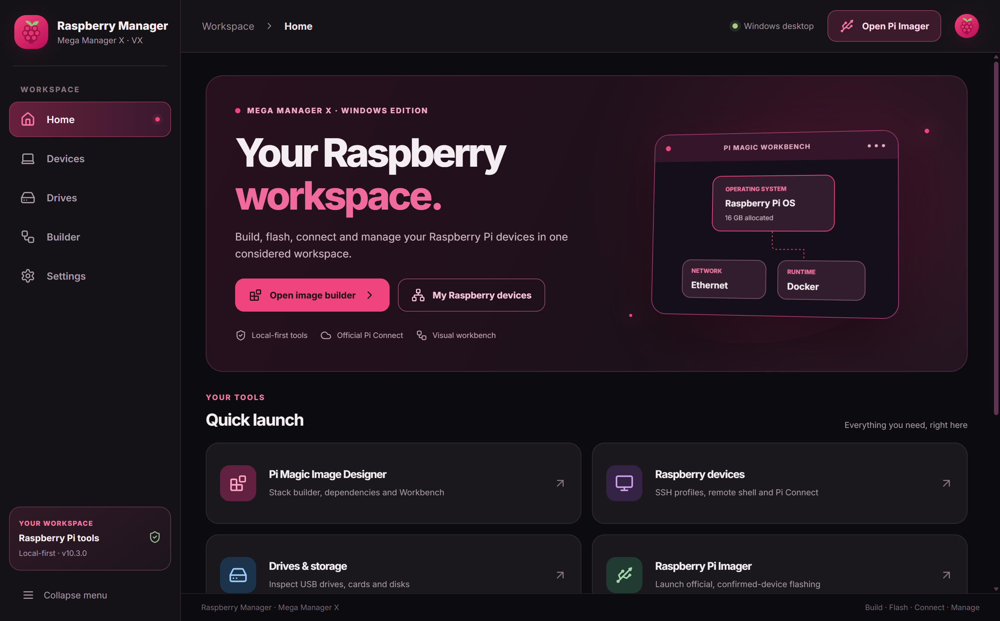
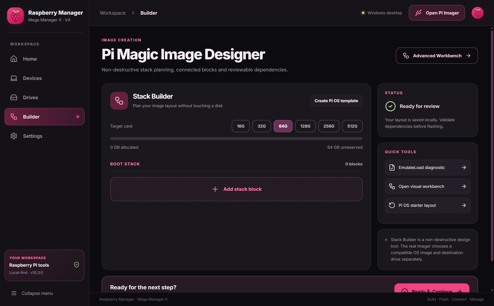
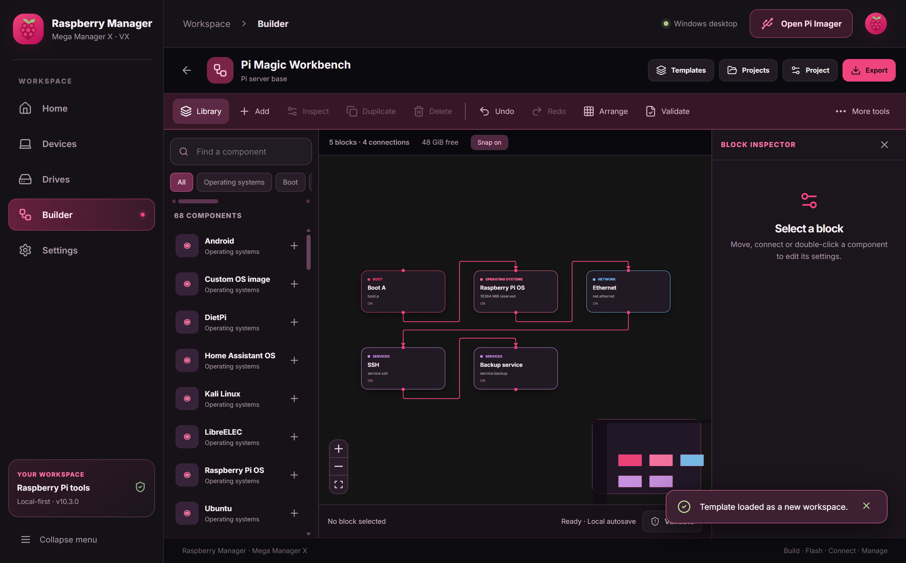

# Raspberry Manager — Windows desktop



The Windows companion is built with **Electron 45, React, TypeScript, Vite, React Flow, ssh2 and xterm.js**. It shares the Raspberry Berry visual identity and central Workbench JSON schema with Android.

## Included

- Home dashboard and main navigation.
- Pi Magic Image Designer with capacity/dependency validation and Ready → EmulateLoad / Imager flow.
- Visual Workbench containing a 68-type catalog generated from the Android source, node/edge controls, panels, templates, validation, JSON/SVG export and a simulated dependency report.
- SSH profiles, password/private-key login, host-key approval and terminal.
- Raspberry Pi Connect in a separate, embedded Chromium profile.
- Read-only Windows storage inventory.
- Official Imager launch, or explicit installation prompt if a bundled upstream installer is present.

> Real device write operations are **not** performed by the Workbench. Physical flashing remains in the official Raspberry Pi Imager.

## Development

Requirements: Windows x64, Node.js 24, npm.

```powershell
cd windows
npm ci
npx tsc --noEmit
npm test
npm run build:web
npm run dev
```

Create an NSIS installer:

```powershell
npm run build
```

The output is `release/RaspberryManager-Windows-v10.3.0-Setup.exe`.

### Optional official Raspberry Pi Imager installer

The release Windows build can embed the **unaltered** official upstream installer `assets/imager-v2.0.12.exe`. This file is intentionally excluded from Git source control to keep the repository light. Without it, the app searches for an installed Imager and otherwise opens the official upstream download page.

Official website: https://www.raspberrypi.com/software/  
Official source: https://github.com/raspberrypi/rpi-imager

### Component generation

```powershell
python scripts/generate-catalog.py
python scripts/generate-assets.py
```

The first command derives the catalog from `../android/source/.../WorkbenchCatalog.kt`. The second creates the app icon and original visual assets.

## Process separation and security

- Electron `desktop/main.cjs` owns filesystem access, credential use, native storage inventory, SSH connections and Connect's embedded web contents.
- `desktop/preload.cjs` exposes an explicit IPC interface rather than broad Node access.
- The renderer `src/` handles visual interaction, editor state, validation, and bounded import/export.
- SSH profiles persist host, user and key **path**, not SSH passwords.
- First-time SSH host fingerprints are presented for explicit approval.
- The Connect browser uses the `persist:rm-connect` partition with an official-host allowlist.
- Raspberry Pi Connect's own provider runtime performs WebRTC communication. The app does not hold or forge independent OAuth sessions.
- Windows drive information is read-only and does not directly initiate disk writes.

Known limits: built-in validation does not prove all physical Pi/Windows hardware combinations, runtime Connect compatibility, or every possible Android Workbench feature.

## Screenshots

| Home | Image Designer |
| :-- | :-- |
|  |  |



All screenshots were captured from the running desktop app.

See [the root README](../README.md) for downloads and full project details.
